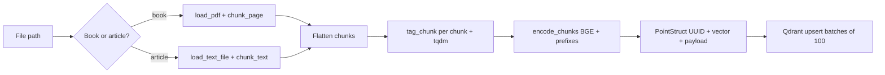
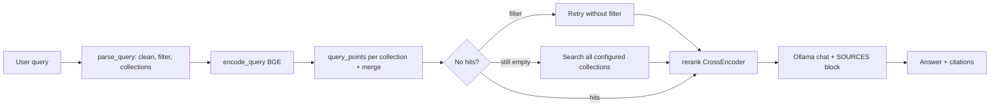

# Ayurvedic RAG — Implementation Overview

This folder implements a **full RAG backend**: it **ingests** Ayurvedic books and articles (chunk, tag, embed, upsert to Qdrant Cloud), and **answers questions** via **vector search → cross-encoder re-ranking → Ollama** generation with grounded citations.

---

## Stack

| Layer | Technology |
|--------|------------|
| API | FastAPI, Uvicorn, Pydantic |
| Config | `python-dotenv` (`.env` per module that needs it) |
| Vector DB | Qdrant Cloud (`qdrant-client`; `query_points` for search) |
| Embeddings | `sentence-transformers` (default: `BAAI/bge-large-en-v1.5`, 1024-dim, cosine) |
| Re-ranking | `sentence-transformers` **CrossEncoder** (default: `cross-encoder/ms-marco-MiniLM-L-6-v2`) |
| Answer LLM | **Ollama** over HTTP (`httpx`), model from `OLLAMA_MODEL` or `LLM_MODEL` |
| PDF text | PyMuPDF (`fitz`) |
| Chunking | `langchain-text-splitters` — `RecursiveCharacterTextSplitter` only |
| Ingest metadata LLM | Google Gemini (`google-generativeai`) — optional tagging only |
| Dataset helper | `kagglehub` + `download_ayurveda_dataset.py` |

---

## Repository layout

```
rag/
├── .env                    # Secrets (not committed); see Environment
├── requirements.txt
├── main.py                 # FastAPI app + lifespan + health; mounts ingest + query routers
├── setup.sh                # Bash venv setup (optional on Windows)
├── download_ayurveda_dataset.py   # Kaggle dataset download (Windows long-path aware)
├── config/
│   └── vectordb.py         # Qdrant singleton client + collection bootstrap
├── routes/
│   ├── ayurvedic_routes.py      # HTTP API — ingestion + status
│   └── ayurvedic_query_routes.py # HTTP API — query, search-only, parse, session
├── services/
│   ├── ayurvedic_ingest.py      # End-to-end ingest orchestration
│   ├── ayurvedic_retrieval.py   # Qdrant search + retrieval fallbacks + rerank hook
│   └── ayurvedic_generation.py  # Ollama chat + system prompt + citations
└── utils/
    ├── pdf_loader.py
    ├── chunker.py
    ├── embeddings.py       # encode_chunks, encode_query (BGE + prefixes)
    ├── metadata_tagger.py  # Gemini tagging for ingest (optional)
    ├── query_parser.py     # Rule-based intent, filters, collection routing
    └── reranker.py         # Cross-encoder re-ranking
```

---

## Environment variables

Loaded via `load_dotenv()` in each file that needs them. Typical keys:

| Variable | Role |
|----------|------|
| `QDRANT_URL` | Qdrant Cloud cluster URL |
| `QDRANT_API_KEY` | Qdrant API key |
| `COLLECTION_BOOKS` | Collection name for book chunks (e.g. `ayur_books`) |
| `COLLECTION_ARTICLES` | Collection name for article chunks (e.g. `ayur_articles`) |
| `EMBEDDING_MODEL` | Hugging Face model id for `SentenceTransformer` |
| `CHUNK_SIZE` / `CHUNK_OVERLAP` | Chunker settings (ints) |
| `RETRIEVAL_TOP_K` | Initial vector hits per collection merge (default 20); API `top_k` overrides |
| `RERANK_TOP_N` | Passages kept after cross-encoder (default 5); API `top_n` overrides when set and positive |
| `RERANKER_MODEL` | CrossEncoder id (required at first rerank) |
| `OLLAMA_BASE_URL` | Ollama server base URL (default `http://127.0.0.1:11434`) |
| `OLLAMA_MODEL` | Model tag for chat (fallback: `LLM_MODEL` if not Gemini-prefixed) |
| `OLLAMA_TIMEOUT_SEC` | Chat request timeout seconds (default 300, min 30) |
| `MAX_CONTEXT_CHARS` | Cap on source text passed into the model prompt |
| `CONVERSATION_MEMORY_TURNS` | Max conversation **turns** (user+model pairs) per session; stored messages = turns × 2 |
| `LLM_MODEL` | Used for Ollama if `OLLAMA_MODEL` unset; also Gemini model id for **ingest tagging** |
| `GEMINI_API_KEY` | Required for real LLM tagging on ingest; otherwise semantic fields use defaults |
| `DATASET_BOOKS_DIR` | Logical “books root” for classifying paths as books |
| `DATASET_ARTICLES_DIR` | Documented for layout; routing uses books rule + `.pdf` for “book” |

Paths like `DATASET_*` are resolved relative to the **process current working directory** (run the app from `rag/`).

**Note:** On `POST /api/v1/query`, if `top_n` is omitted, zero, or negative, the service uses `RERANK_TOP_N` from the environment (via `retrieve()`). `POST /api/v1/query/search-only` passes `top_n` through as-is for debugging.

---

## Qdrant collections

On application startup, `bootstrap_collections()` in `config/vectordb.py`:

1. Ensures both named collections exist with **vector size 1024** and **cosine** distance (aligned with BGE-large-en-v1.5).
2. Creates **payload indexes** (keyword unless noted) on:  
   `source_type`, `dosha_type`, `ayur_category`, `content_focus`, `has_sanskrit` (bool), `document_title`, `body_system`.

Search uses **`client.query_points(...)`** with the query vector, **`with_payload=True`**, and an optional **`query_filter`**. There is no legacy `search()` API on current `qdrant-client`.

---

## Ingestion pipeline (single document)

Implemented in `services/ayurvedic_ingest.py` and exposed asynchronously as `ingest_document()`.



### Book vs article

- **Book** if the file is **`.pdf`** *or* its resolved path is **under** `DATASET_BOOKS_DIR`.
- Otherwise **article** (e.g. `.txt` under a texts folder).

Books use `COLLECTION_BOOKS`; articles use `COLLECTION_ARTICLES`.

### Loading and chunking

- **PDF** (`utils/pdf_loader.py`): one record per page with `text`, `page_number`, `file_name`, `document_title`. Pages with fewer than **40** non-whitespace characters are skipped.
- **Text** (`load_text_file`): whole file as one string; UTF-8 with replacement on decode errors.
- **Chunking** (`utils/chunker.py`): `RecursiveCharacterTextSplitter` with separators `["\n\n", "\n", ". ", " ", ""]`, sizes from `CHUNK_SIZE` / `CHUNK_OVERLAP`. Each chunk gets `chunk_index` and inherited metadata (`page_number`, `file_name`, `document_title` as applicable).

### Tagging (`utils/metadata_tagger.py`)

1. **Structural (always):** `source_type`, `has_sanskrit` (Devanagari regex or transliterated Ayurveda terms), `word_count`, `language_complexity` (`classical` if `word_count < 200` else `detailed`).
2. **Semantic (optional):** Gemini JSON extraction into `ayur_category`, `dosha_type`, `content_focus`, `herbs_mentioned`, `diseases_mentioned`, `body_system`, `season_relevance`. On missing key, parse errors, or API errors → **safe defaults** and logging.

`use_llm=False` skips Gemini and fills semantic keys from defaults.

### Embeddings (`utils/embeddings.py`)

- Model loaded lazily once.
- Chunks: prefix `"Represent this Ayurvedic passage for retrieval: "` then encode in **batches of 32** with `normalize_embeddings=True`; store as `embedding` on the dict (list of floats).
- Queries: prefix `"Represent this question for searching Ayurvedic knowledge: "` (`encode_query`).

### Qdrant points

- **ID:** string UUID per chunk.
- **Vector:** embedding only (never stored in payload).
- **Payload:** all chunk fields **except** `embedding`, which **includes** `text` so the passage can be returned at retrieval time. Additional fields from tagging (e.g. `herbs_mentioned`, `season_relevance`) are stored even if not all are indexed.

Upserts run in batches of **100** with try/except logging on failure.

Heavy steps run under `asyncio.to_thread` so the async API stays non-blocking for CPU/IO bound work.

---

## Query pipeline (retrieval + answer)



`services/ayurvedic_retrieval.py`:

1. Parses the query again (same rules as `utils/query_parser.py`) to get `cleaned_query`, optional **Qdrant `Filter`**, and **target collections** (books vs articles vs both).
2. Embeds `cleaned_query` and runs **`query_points`** on each target collection with `limit=top_k`, merges hits, sorts by score.
3. **Fallbacks:** if no results with metadata filter → **retry without filter**. If still empty and routing used a subset of collections → **search all** configured collections (`COLLECTION_BOOKS` + `COLLECTION_ARTICLES`) without filter.
4. Cross-encoder **re-ranks** merged payloads; keeps top **`top_n`** (minimum 1 when env/API provides values).

`services/ayurvedic_generation.py`:

- Builds a **Dhanvantari** system prompt: trust `[SOURCE N]` passages, cite inline, no provenance disclaimers, no invented facts.
- Calls Ollama **`POST {OLLAMA_BASE_URL}/api/chat`** with labeled source passages and optional **conversation history** (in-memory sessions).
- Returns structured **citations** (index, title, page, snippet) and **`model_used`**.

If retrieval returns no chunks, **`POST /query`** responds with **404** (`No relevant Ayurvedic passages found.`).

---

## HTTP API — Ingestion (`routes/ayurvedic_routes.py`)

Router prefix: **`/api/v1`**, tag: `ingestion`.

| Method | Path | Description |
|--------|------|-------------|
| `POST` | `/api/v1/ingest/file` | Body: `file_path`, `use_llm_tagging` (default `true`). Ingest one file. |
| `POST` | `/api/v1/ingest/directory` | Body: `directory_path`, `use_llm_tagging` (default `false`), `file_extensions` (default `[".pdf",".txt"]`). Walks tree; **semaphore 4** + `asyncio.gather` for concurrency. |
| `GET` | `/api/v1/ingest/status` | Point counts for `COLLECTION_BOOKS` and `COLLECTION_ARTICLES`. |

Root **`GET /`** (in `main.py`): `{"status":"ok","service":"ayurvedic-rag"}`.

File discovery and `get_collection` run in **`asyncio.to_thread`** where applicable.

---

## HTTP API — Query (`routes/ayurvedic_query_routes.py`)

Router prefix: **`/api/v1`**, tag: `query`.

| Method | Path | Description |
|--------|------|-------------|
| `POST` | `/api/v1/query` | Full RAG: parse → retrieve → rerank → Ollama. Body: `query`, optional `top_k`, `top_n`, `source_type_override` (`book` / `article`), `use_conversation`, `session_id` (required if conversation on). Returns answer, citations, chunk counts, `model_used`. |
| `POST` | `/api/v1/query/search-only` | Same retrieval path **without** LLM; returns re-ranked `RetrievedChunk` list. |
| `GET` | `/api/v1/query/parse?q=...` | Debug: JSON intent (cleaned query, collections, doshas, category, filter). |
| `DELETE` | `/api/v1/query/session/{session_id}` | Clears **in-memory** history for that session (use Redis etc. for multi-instance). |

---

## Dataset download

`download_ayurveda_dataset.py` pulls **`rcratos/ayurveda-texts-english`** via `kagglehub`. On Windows it defaults to a **short drive-root folder** (e.g. `D:\k`) to reduce `MAX_PATH` issues; if kagglehub’s unzip still fails, the script can **finish extraction** using `\\?\` long paths. Overrides: `KAGGLEHUB_OUTPUT_DIR`, `AYUR_KAGGLE_OUTPUT`, or `--output-dir` / `--force`.

Large local trees are typically git-ignored at repo root (e.g. `ayurveda_books/`, `ayurveda_texts/`); align `DATASET_*` paths with where you store downloads.

---

## Running locally

From **`ai-service/rag`** (so imports and `.env` paths resolve):

```bash
python -m venv .venv
# activate venv, then:
pip install -r requirements.txt
python -m uvicorn main:app --host 0.0.0.0 --port 8000
```

Requires valid **Qdrant** credentials at startup (collections are bootstrapped in the lifespan hook). For **`POST /query`**, run **Ollama** locally (or point `OLLAMA_BASE_URL` elsewhere) and **pull** the model matching `OLLAMA_MODEL` / `LLM_MODEL`. The cross-encoder downloads on first rerank (`RERANKER_MODEL`).

---

## Scope notes

- **In scope:** ingest, enrich, embed, upsert, collection status, **semantic search, rerank, grounded answers**, optional **multi-turn** sessions (process-local).
- **LangChain** is used **only** for text splitting; Qdrant, embeddings, reranker, and Ollama use native SDKs / HTTP.
- **Gemini** is used for **ingest-time chunk tagging** when enabled; answers are **not** generated with Gemini in the current `ayurvedic_generation` implementation.
